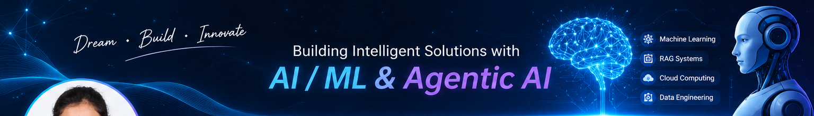

 

# Gangana Vinaya Chandrika Reddy

### AI/ML Engineer Aspirant | Computer Science Engineering Student

**Building Intelligent Solutions with Python, Machine Learning, Agentic AI and Cloud Technology.**

[Portfolio](https://vinaya-chandrika.vercel.app/) ·
[LinkedIn](https://www.linkedin.com/in/vinaya-chandrika-gangana-200880363/) ·
[GitHub](https://github.com/vinaya18-2006)

---

## 👩‍💻 About Me

Hello! I'm **Vinaya**, a Computer Science Engineering student graduating in 2027. I enjoy building practical software projects and exploring how Artificial Intelligence can solve real-world problems.

- 🤖 Exploring Artificial Intelligence, Machine Learning and Agentic AI.
- 🧠 Learning Retrieval-Augmented Generation (RAG) and multi-agent workflows.
- 🐍 Building applications using Python.
- ☁️ Interested in Cloud Computing and Data Engineering.
- 🌱 Continuously improving my problem-solving and software engineering skills.

## 🛠️ Technical Skills

| Category | Technologies |
|---|---|
| Programming | Python, C++, SQL |
| AI & ML | Machine Learning, Scikit-learn, Pandas, NumPy, Computer Vision |
| Generative AI | Agentic AI, RAG |
| Cloud | AWS, Azure Data Factory, Azure SQL |
| Analytics | Power BI |
| Tools | Streamlit, Git, GitHub, Linux, Postman |

## 🚀 Featured Projects

### 1. Agentic Churn Intelligence

AI/ML-based customer churn prediction, evidence-based explanations and retention recommendations using an agentic workflow.

**Technologies:** Python · Machine Learning · RAG · Agentic AI

[View Repository](https://github.com/vinaya18-2006/Agentic-Churn-Intelligence)

### 2. CareerPilot AI

A job discovery and matching application that helps users explore relevant job opportunities and understand resume-to-job alignment.

**Technologies:** Python · Streamlit · Pandas · NumPy · Scikit-learn

[View Repository](https://github.com/vinaya18-2006/CareerPilot-AI) · [Live Application](https://careerpilot-ai-7e3qphr8mnubs6ghj6.streamlit.app/)

### 3. Azure ETL Pipeline

A data engineering project demonstrating data extraction, transformation and loading using Azure services.

**Technologies:** Azure Data Factory · Azure SQL · Power BI · Python · SQL

[View Repository](https://github.com/vinaya18-2006/azure-etl-pipeline)

## 📚 Currently Learning

- Machine Learning and model evaluation
- Agentic AI and RAG architectures
- Data Structures and Algorithms
- Cloud-based AI applications
- Software Engineering and System Design

## 🎓 Education

**B.Tech – Computer Science and Engineering**

Vivekanandha College of Engineering for Women

Expected Graduation: **2027**

## 🤝 Connect With Me

- **Portfolio:** https://vinaya-chandrika.vercel.app/
- **LinkedIn:** https://www.linkedin.com/in/vinaya-chandrika-gangana-200880363/
- **GitHub:** https://github.com/vinaya18-2006

---

### ✨ Learn · Build · Experiment · Improve

Thanks for visiting my profile!

